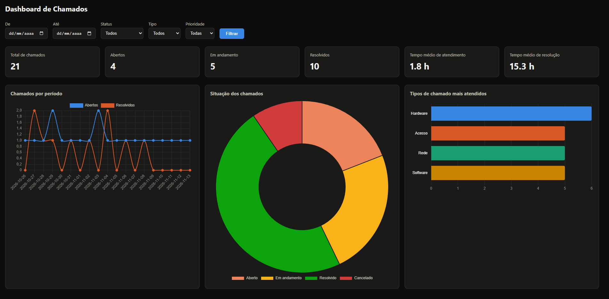
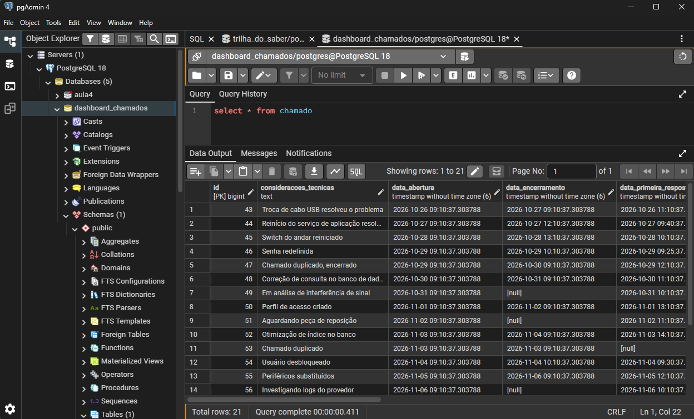
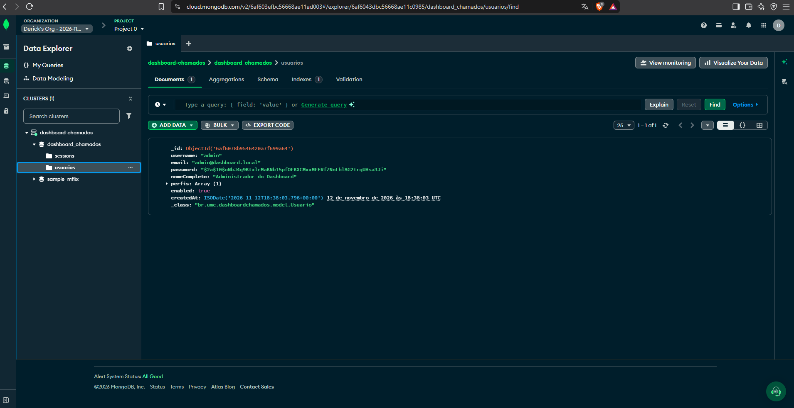

# Dashboard Administrativo de Chamados Técnicos — Documentação

Atividade Prática M2 — Projeto e desenvolvimento de software corporativo (UMC)

## 1. Contextualização

O sistema disponibiliza um dashboard administrativo integrado a um sistema de chamados técnicos. O painel consome dados de uma API própria, projetada e implementada para alimentar indicadores, gráficos, rankings e filtros de consulta.

## 2. Requisitos Funcionais

| Código | Descrição | Onde está implementado |
|---|---|---|
| RF01 | Indicadores gerais de chamados técnicos (total, por status, tempos médios de atendimento e resolução) | `GET /api/chamados/indicadores`, cards no topo do dashboard |
| RF02 | Análise de chamados atendidos por período, em gráfico | `GET /api/chamados/por-periodo`, gráfico de linha "Chamados por período" |
| RF03 | Situação dos chamados | `GET /api/chamados/situacao`, gráfico de rosca "Situação dos chamados" |
| RF04 | Tipos de chamado mais atendidos | `GET /api/chamados/tipos-mais-atendidos`, gráfico de barras "Tipos de chamado mais atendidos" |
| RF05 | Filtros de consulta (período, status, tipo e prioridade) | Query params aceitos por todos os endpoints de leitura; formulário de filtros no topo do dashboard |
| RF06 | Integração com a API | O dashboard (Thymeleaf + JavaScript) consome exclusivamente os endpoints REST abaixo, via `fetch` |
| RF07 | Atualização e tratamento de dados | `GlobalExceptionHandler` trata erros de validação e de recurso não encontrado; o front trata o retorno assíncrono e exibe os dados já agregados pelo backend |

## 3. Requisitos Não Funcionais

- **Desempenho**: os endpoints de agregação (indicadores, por período, situação, tipos mais atendidos) calculam os totais no backend, evitando que o front processe a lista crua de chamados.
- **Usabilidade**: layout responsivo (grid que se adapta a telas menores), com filtros sempre visíveis no topo.
- **Confiabilidade / tratamento de erro**: respostas de erro padronizadas (`timestamp`, `status`, `mensagem`), vindas do `GlobalExceptionHandler`.
- **Manutenibilidade**: separação em camadas — `model` (entidades e enums), `repository` (acesso a dados e filtros dinâmicos via `Specification`), `service` (regras de negócio e agregações), `controller` (exposição REST e da view), `dto` (contratos de entrada/saída), `exception` (tratamento de erros).
- **Acessibilidade visual**: paleta de cores dos gráficos validada para contraste e para distinção entre pares adjacentes sob daltonismo (protanopia/tritanopia).
- **Segurança / controle de acesso**: dashboard e API protegidos por autenticação de sessão (Spring Security, usuário com perfil `ADMIN`), reaproveitando a base de login desenvolvida no projeto anterior (ConstruCerta), com persistência de usuários e sessões em MongoDB Atlas, separada do banco relacional (PostgreSQL) usado para os chamados.

## 4. Modelo de dados

**Chamado**

| Campo | Tipo | Observação |
|---|---|---|
| id | Long | gerado automaticamente |
| titulo | String | obrigatório |
| descricao | String | opcional |
| tipo | Enum (`HARDWARE`, `SOFTWARE`, `REDE`, `ACESSO`, `OUTROS`) | obrigatório |
| status | Enum (`ABERTO`, `EM_ANDAMENTO`, `RESOLVIDO`, `CANCELADO`) | obrigatório |
| prioridade | Enum (`BAIXA`, `MEDIA`, `ALTA`, `URGENTE`) | obrigatório |
| solicitante | String | obrigatório |
| responsavel | String | opcional, preenchido quando o chamado é assumido |
| consideracoesTecnicas | String | opcional, observações do atendimento |
| dataAbertura | LocalDateTime | preenchida automaticamente na criação |
| dataPrimeiraResposta | LocalDateTime | preenchida automaticamente quando o status sai de `ABERTO` |
| dataEncerramento | LocalDateTime | preenchida automaticamente quando o status vira `RESOLVIDO` ou `CANCELADO` |

## 5. Documentação dos endpoints

Todos os endpoints de leitura abaixo aceitam, como query params opcionais, os filtros de consulta do RF05: `dataInicio` (`AAAA-MM-DD`), `dataFim` (`AAAA-MM-DD`), `status`, `tipo` e `prioridade`. Quando omitidos, o endpoint considera todos os chamados.

### 5.1. `GET /api/chamados`

Lista os chamados que atendem aos filtros informados.

**Exemplo de requisição**
```
GET /api/chamados?status=ABERTO&tipo=REDE
```

**Exemplo de resposta — 200 OK**
```json
[
  {
    "id": 19,
    "titulo": "Latência alta entre filiais",
    "descricao": "Lentidão na comunicação entre matriz e filial",
    "tipo": "REDE",
    "status": "ABERTO",
    "prioridade": "MEDIA",
    "solicitante": "Thiago Moreira",
    "responsavel": null,
    "consideracoesTecnicas": null,
    "dataAbertura": "2026-11-10T09:00:00",
    "dataPrimeiraResposta": null,
    "dataEncerramento": null
  }
]
```

### 5.2. `GET /api/chamados/{id}`

Busca um chamado específico.

**Exemplo de resposta — 200 OK**
```json
{
  "id": 1,
  "titulo": "Impressora não imprime",
  "descricao": "Impressora do setor financeiro parou de responder",
  "tipo": "HARDWARE",
  "status": "RESOLVIDO",
  "prioridade": "MEDIA",
  "solicitante": "Ana Souza",
  "responsavel": "Carlos Lima",
  "consideracoesTecnicas": "Troca de cabo USB resolveu o problema",
  "dataAbertura": "2026-10-25T10:00:00",
  "dataPrimeiraResposta": "2026-10-25T12:00:00",
  "dataEncerramento": "2026-10-26T10:00:00"
}
```

**Erro — 404 Not Found** (id inexistente)
```json
{
  "timestamp": "2026-11-12T14:32:10.123",
  "status": 404,
  "mensagem": "Chamado não encontrado com id 999"
}
```

### 5.3. `POST /api/chamados`

Cria um novo chamado.

**Corpo da requisição**
```json
{
  "titulo": "Teclado não funciona",
  "descricao": "Teclado da estação 7 parou de responder",
  "tipo": "HARDWARE",
  "status": "ABERTO",
  "prioridade": "BAIXA",
  "solicitante": "Maria Fernandes"
}
```

**Exemplo de resposta — 200 OK**
```json
{
  "id": 22,
  "titulo": "Teclado não funciona",
  "descricao": "Teclado da estação 7 parou de responder",
  "tipo": "HARDWARE",
  "status": "ABERTO",
  "prioridade": "BAIXA",
  "solicitante": "Maria Fernandes",
  "responsavel": null,
  "consideracoesTecnicas": null,
  "dataAbertura": "2026-11-12T14:40:00",
  "dataPrimeiraResposta": null,
  "dataEncerramento": null
}
```

**Erro — 400 Bad Request** (campo obrigatório ausente, por exemplo `titulo` vazio)
```json
{
  "timestamp": "2026-11-12T14:41:00.456",
  "status": 400,
  "mensagem": "titulo: não deve estar em branco"
}
```

### 5.4. `PUT /api/chamados/{id}`

Atualiza os dados de um chamado existente. Mesmo corpo de requisição do `POST`. Retorna 404 se o id não existir, nos mesmos termos do item 5.2.

### 5.5. `PATCH /api/chamados/{id}/status`

Atualiza apenas o status de um chamado. Preenche automaticamente `dataPrimeiraResposta` (se o chamado saía de `ABERTO`) e `dataEncerramento` (se o novo status for `RESOLVIDO` ou `CANCELADO`).

**Corpo da requisição**
```json
{
  "status": "EM_ANDAMENTO"
}
```

**Exemplo de resposta — 200 OK**
```json
{
  "id": 22,
  "titulo": "Teclado não funciona",
  "status": "EM_ANDAMENTO",
  "dataAbertura": "2026-11-12T14:40:00",
  "dataPrimeiraResposta": "2026-11-12T15:10:00",
  "dataEncerramento": null,
  "...": "demais campos omitidos"
}
```

### 5.6. `GET /api/chamados/indicadores`

Indicadores gerais (RF01).

**Exemplo de resposta — 200 OK**
```json
{
  "totalChamados": 21,
  "totalAbertos": 5,
  "totalEmAndamento": 5,
  "totalResolvidos": 9,
  "totalCancelados": 2,
  "tempoMedioAtendimentoHoras": 1.8,
  "tempoMedioResolucaoHoras": 22.4
}
```

`tempoMedioAtendimentoHoras` e `tempoMedioResolucaoHoras` retornam `null` quando não há dados suficientes para o cálculo (por exemplo, nenhum chamado respondido no período filtrado).

### 5.7. `GET /api/chamados/por-periodo`

Série temporal de chamados abertos e resolvidos (RF02). Aceita o parâmetro adicional `agrupamento` (`DIA`, `SEMANA` ou `MES`; padrão `DIA`).

**Exemplo de requisição**
```
GET /api/chamados/por-periodo?agrupamento=SEMANA
```

**Exemplo de resposta — 200 OK**
```json
[
  { "periodo": "2026-10-26", "abertos": 3, "resolvidos": 2 },
  { "periodo": "2026-11-02", "abertos": 4, "resolvidos": 3 },
  { "periodo": "2026-11-09", "abertos": 2, "resolvidos": 1 }
]
```

### 5.8. `GET /api/chamados/situacao`

Distribuição de chamados por status (RF03).

**Exemplo de resposta — 200 OK**
```json
[
  { "status": "ABERTO", "quantidade": 5 },
  { "status": "EM_ANDAMENTO", "quantidade": 5 },
  { "status": "RESOLVIDO", "quantidade": 9 },
  { "status": "CANCELADO", "quantidade": 2 }
]
```

### 5.9. `GET /api/chamados/tipos-mais-atendidos`

Ranking dos tipos de chamado com mais ocorrências (RF04). Aceita o parâmetro adicional `topN` (padrão `5`).

**Exemplo de requisição**
```
GET /api/chamados/tipos-mais-atendidos?topN=3
```

**Exemplo de resposta — 200 OK**
```json
[
  { "tipo": "HARDWARE", "quantidade": 7 },
  { "tipo": "SOFTWARE", "quantidade": 5 },
  { "tipo": "REDE", "quantidade": 5 }
]
```

### 5.10. Erros gerais

Qualquer erro não mapeado explicitamente retorna **500 Internal Server Error** no mesmo formato:
```json
{
  "timestamp": "2026-11-12T14:50:00.789",
  "status": 500,
  "mensagem": "Erro interno: <detalhe da exceção>"
}
```

### 5.11. Autenticação

O acesso ao dashboard e a todos os endpoints de `/api/chamados/**` exige sessão autenticada com perfil `ADMIN`.

**Login — `POST /login`**

Parâmetros de formulário (`application/x-www-form-urlencoded`): `login` e `password`.

**Exemplo de requisição**
```bash
curl -i -c cookies.txt -d "login=admin&password=TrocarSenha123!" http://localhost:8080/login
```

**Exemplo de resposta — 302 Found (sucesso)**
```
HTTP/1.1 302
Set-Cookie: SESSION=...; Path=/; HttpOnly; SameSite=Lax
Location: http://localhost:8080/dashboard
```

Em caso de credenciais inválidas, o usuário é redirecionado para `/login?error` (401 implícito via redirecionamento, com mensagem exibida na própria tela de login). Requisições sem sessão válida para qualquer rota protegida são redirecionadas para `/login`; requisições autenticadas sem o perfil `ADMIN` recebem a página `/403`.

**Logout — `POST /logout`**

Encerra a sessão e invalida os cookies (`JSESSIONID`, `SESSION`), redirecionando para `/login?logout`.

## 6. Evidências de teste

### 6.1. Autenticação

Login realizado via terminal, confirmando sessão autenticada e redirecionamento ao dashboard:

```bash
curl.exe -i -c cookies.txt -d "login=admin&password=TrocarSenha123!" http://localhost:8080/login
```

```
HTTP/1.1 302
Set-Cookie: SESSION=OWFjNDI1MWEtYjcwYi00NTRkLWJmMjMtNzBkMzA5OTU2Njg2; Path=/; HttpOnly; SameSite=Lax
Location: http://localhost:8080/dashboard
```

### 6.2. RF01 — Indicadores gerais

```bash
curl.exe -b cookies.txt http://localhost:8080/api/chamados/indicadores
```

```json
{"totalChamados":21,"totalAbertos":4,"totalEmAndamento":5,"totalResolvidos":10,"totalCancelados":2,"tempoMedioAtendimentoHoras":1.85,"tempoMedioResolucaoHoras":15.3}
```

### 6.3. RF02 — Análise por período

```bash
curl.exe -b cookies.txt "http://localhost:8080/api/chamados/por-periodo?agrupamento=DIA"
```

```json
[{"periodo":"2026-10-25","abertos":1,"resolvidos":0},{"periodo":"2026-10-26","abertos":1,"resolvidos":2},{"periodo":"2026-10-27","abertos":1,"resolvidos":1},{"periodo":"2026-10-28","abertos":2,"resolvidos":1},{"periodo":"2026-10-29","abertos":1,"resolvidos":0}]
```
*(resposta completa inclui um registro por dia até a data de execução)*

### 6.4. RF03 — Distribuição por status

```bash
curl.exe -b cookies.txt http://localhost:8080/api/chamados/situacao
```

```json
[{"status":"ABERTO","quantidade":4},{"status":"EM_ANDAMENTO","quantidade":5},{"status":"RESOLVIDO","quantidade":10},{"status":"CANCELADO","quantidade":2}]
```

### 6.5. RF04 — Tipos de chamado mais atendidos

```bash
curl.exe -b cookies.txt "http://localhost:8080/api/chamados/tipos-mais-atendidos?topN=5"
```

```json
[{"tipo":"HARDWARE","quantidade":6},{"tipo":"ACESSO","quantidade":5},{"tipo":"REDE","quantidade":5},{"tipo":"SOFTWARE","quantidade":5}]
```

### 6.6. RF05 — Filtros

Testado manualmente pela interface do dashboard: ao selecionar um intervalo de datas, status, tipo e prioridade e clicar em "Filtrar", os cartões de indicadores e os três gráficos são recalculados de acordo com os filtros aplicados, confirmando que os parâmetros `dataInicio`, `dataFim`, `status`, `tipo` e `prioridade` funcionam de forma combinada em todos os endpoints de leitura.

### 6.7. Dashboard (interface)

Dashboard em `http://localhost:8080/dashboard`, autenticado como `admin`, com os 21 chamados de exemplo, indicadores, filtros e os três gráficos renderizados:



### 6.8. Banco de dados

**PostgreSQL** — tabela `chamado` populada (21 registros, consultada via pgAdmin):



**MongoDB Atlas** — coleção `usuarios`, confirmando o usuário `ADMIN` criado automaticamente pelo `AdminInitializer` (senha armazenada com hash BCrypt):



## 7. Como executar

Ver `README.md` na raiz do projeto.
